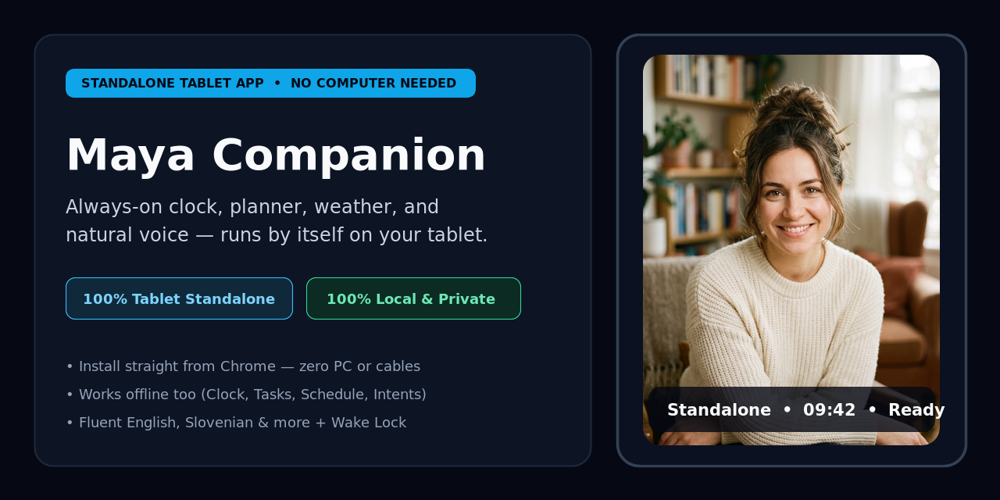

# Maya Companion



**Maya Companion** is an independent, always-on personal assistant, ambient clock, daily planner, and natural voice companion built to run directly on **Android tablets**, **Android phones**, and **iPhones/iPads** — completely by itself, with **no computer or PC connection required**.

Designed for zero-scroll horizontal tablet stands (`1280×800`) as well as portrait tablets and phones, Maya combines a calm full-screen dashboard with fluent multilingual conversation (including native Slovenian and English) and keeps all personal data strictly on your device.

> **Interactive Deck & Video**
> - Open [`docs/presentation.html`](docs/presentation.html) in any browser for the full interactive presentation.
> - Download or play [`docs/maya-android-tablet-install.mp4`](docs/maya-android-tablet-install.mp4) for the standalone tablet installation walkthrough video.


---

## Key Features

- **100% Standalone on Your Tablet (No PC Required)**: Opens straight from your tablet browser and installs onto your home screen as a dedicated full-screen app that runs independently on Wi-Fi or mobile data — and keeps working even offline.
- **Always-On Desk & Bedside Display**: Zero-scroll landscape layout for Android tablets (Huawei MediaPad, Samsung Galaxy Tab, Lenovo Tab, Xiaomi Pad, etc.), automatic Screen Wake Lock, **Night Dim** mode, and a one-tap **Clock & Maya** standby view.
- **Natural Multilingual Voice**: Expressive voice synthesis and real-time voice conversation in Slovenian, English, German, and more with automatic language detection and native on-device voice fallback.
- **Works Even Offline**: Clock, date, weather cache, daily wishes, tasks, schedule, Pomodoro timer, and quick local voice commands (*time, date, weather, add task, schedule*) continue running directly on the tablet without internet.
- **Live News & Daily Context**: Clean, concise spoken news summaries without publisher clutter, plus neighborhood weather and daily calendar guidance when online.
- **Privacy-First Local Storage**:
  - **Zero server database**, **zero analytics**, and **zero IP logging**.
  - Tasks, schedule, profile, and conversation history stay inside your tablet's `localStorage` with one-tap **Save to Tablet** export and **Erase Local Data**.

---

## Standalone Tablet Installation (No Computer Needed)

Full step-by-step instructions and troubleshooting live in [`docs/ANDROID_TABLET_GUIDE.md`](docs/ANDROID_TABLET_GUIDE.md).

### Install Directly on Any Android Tablet (30 Seconds)
1. On your Android tablet, open **Google Chrome** (or Microsoft Edge) and open your live **Maya Companion HTTPS URL**.
2. Tap **Install** in Maya's top bar — or tap Chrome's **⋮ menu → Install app** (*Add to Home screen* on older Chrome versions).
3. Tap **Install** to add **Maya** as an independent app icon on your home screen.
4. Open **Maya** from your home screen and allow **Microphone** (for voice conversation) and **Location** (optional, for local weather).
5. Place the tablet on a stand or charger — **Screen Wake Lock** automatically keeps the display lit, and Maya runs completely by itself.

### iPhone & iPad (Safari)
1. Open your **Maya Companion HTTPS URL** in **Safari**.
2. Tap the **Share** button → **Add to Home Screen** → **Add**.
3. Launch **Maya** from your home screen in full-screen standalone mode.

---

## Controls at a Glance

| Control | Action |
| :--- | :--- |
| **Clock & Maya / Tasks & Schedule** | Switch between minimal Clock + Maya view and full Planner view |
| **Talk** (or tap Maya's portrait) | Start live voice conversation or 1-tap Voice Turn |
| **Swipe Left / Right on Portrait** | Dismiss or complete the top pending task |
| **History** | Search, read, or export saved conversations directly to your tablet |
| **Maya · Name** | Edit your name, spoken language, calibrate voice sensor, or erase local data |
| **Moon / Sun Icon** | Toggle low-brightness **Night Dim** for bedside use |

---

## Project Structure

```text
maya-companion/
├── docs/
│   ├── ANDROID_TABLET_GUIDE.md         # Standalone Android tablet setup & troubleshooting
│   ├── presentation.html               # Interactive slide presentation
│   ├── maya-android-tablet-install.mp4 # Standalone installation walkthrough video
│   ├── maya-install-preview.gif        # Animated README preview
│   └── preview-banner.png              # Project hero banner
├── public/
│   ├── manifest.json                   # Standalone PWA manifest
│   └── pwa-*.png / icon.svg            # Adaptive & maskable app icons
├── src/
│   ├── components/                     # Watch, Tasks, Schedule, Maya Card, Modals
│   ├── hooks/                          # PWA install lifecycle hook
│   ├── utils/                          # Local storage, audio hardware, weather, voice client
│   └── App.tsx                         # Responsive tablet / phone layout & Screen Wake Lock
└── server.ts                           # Cloud backend service & API proxy
```

---

## Cloud Deployment & Development

Maya is built to be hosted directly in the cloud (Cloud Run, Render, Railway, or Fly.io) so tablets and phones run independently on any Wi-Fi connection without touching a computer at home.

```bash
npm install
cp .env.example .env   # Configure GEMINI_API_KEY in your cloud environment
npm run build
npm start
```

- `npm run dev` — Run development environment on port `3000`
- `npm run build` — Build standalone frontend & offline service worker (`dist/`)
- `npm start` — Start production server serving `dist/` and `/api/*`
- `npm run lint` — Verify TypeScript types (`tsc --noEmit`)
