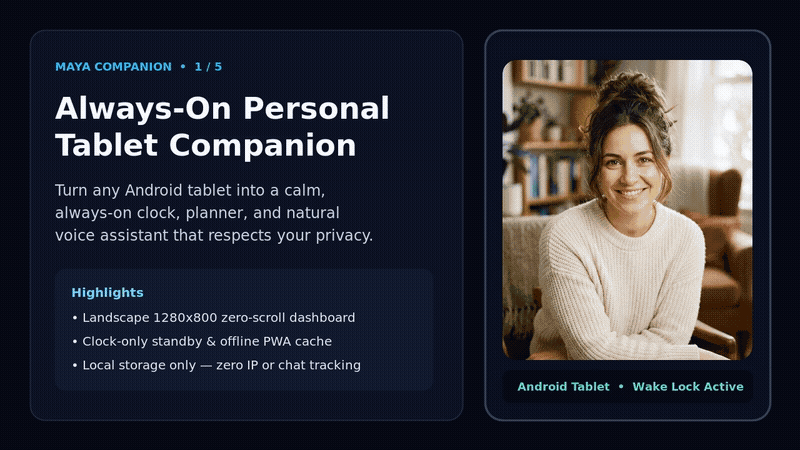

# Maya Companion


**Maya Companion** is an always-on personal assistant, ambient clock, daily planner, and natural voice companion built for **Android tablets**, **Android phones**, **iPhones**, and desktop browsers. Designed for zero-scroll landscape tablet stands (`1280×800`) as well as portrait mobile use, it pairs a calm dashboard with expressive multilingual voice conversation (including native Slovenian and English) and keeps all personal data strictly local on your device.

> **Interactive Deck & Video**
> - Open [`docs/presentation.html`](docs/presentation.html) in any browser for the full interactive presentation.
> - Download or play [`docs/maya-android-tablet-install.mp4`](docs/maya-android-tablet-install.mp4) for the step-by-step installation walkthrough video.



---

## Key Features

- **Android Tablet Always-On Display**: Zero-scroll split layout for horizontal tablets (Huawei MediaPad, Samsung Galaxy Tab, Lenovo Tab, Fire/Android tablets), automatic Screen Wake Lock, **Night Dim** mode, and a one-tap **Clock & Maya** minimalist view.
- **Natural Multilingual Voice**: Expressive human-sounding voice synthesis and real-time voice conversation in Slovenian, English, German, and more with automatic language detection.
- **Live News & Daily Context**: Clean, concise spoken news briefings without website clutter, live neighborhood weather, daily wishes, focus timer (Pomodoro), tasks, and day schedule.
- **Privacy-First Local Storage**:
  - **Zero server database** and **zero IP tracking or analytics**.
  - Tasks, schedule, profile, and conversation history stay exclusively in your device's `localStorage` with one-tap **Save to Tablet** export and **Erase Local Data**.
  - Weather coordinates are rounded to ~1 km neighborhood precision and never stored as exact street addresses.
- **Installable PWA (No Play Store Needed)**: Installs straight from Chrome onto your Android tablet or phone home screen as a full-screen standalone app.

---

## Android Tablet Installation (Quick Guide)

Full illustrated steps are available in [`docs/ANDROID_TABLET_GUIDE.md`](docs/ANDROID_TABLET_GUIDE.md).

### Option 1: Install Directly on Your Android Tablet (Recommended)
1. Open **Google Chrome** (or Microsoft Edge) on your Android tablet and navigate to your hosted HTTPS Maya URL.
2. Tap the **Install** button in the top-right bar (or tap Chrome's **⋮ menu → Install app** / **Add to Home screen**).
3. Confirm **Install**. Maya will appear on your tablet's home screen and launch full-screen without browser bars.
4. When prompted, tap **Allow** for **Microphone** (for voice talk) and **Location** (optional, for local weather).
5. Place your tablet on a desk or bedside stand — **Screen Wake Lock** automatically keeps the clock and Maya visible while the app is open, and you can toggle the **Moon icon** for **Night Dim**.

### Option 2: Run on Your Own PC / Home Server (Same Wi-Fi)
If you want to host Maya yourself on your home network:

```bash
# 1. Clone the repository
git clone https://github.com/<your-username>/maya-companion.git
cd maya-companion

# 2. Install dependencies
npm install

# 3. Configure your environment key
cp .env.example .env
# Edit .env and add your API key

# 4. Build and start the production server
npm run build
npm start
```

- Open `http://localhost:3000` on your computer, or `http://<YOUR_PC_LOCAL_IP>:3000` on your Android tablet on the same Wi-Fi.
- **Important for Android Chrome on plain `http://` LAN URLs**: Android blocks microphone & PWA installation on non-HTTPS LAN addresses by default. On your tablet, open `chrome://flags/#unsafely-treat-insecure-origin-as-secure`, add `http://<YOUR_PC_LOCAL_IP>:3000`, set it to **Enabled**, and relaunch Chrome (or serve Maya over HTTPS with Caddy/Cloudflare Tunnel/Tailscale Serve).

---

## Controls at a Glance

| Control | Action |
| :--- | :--- |
| **Clock & Maya / Tasks & Schedule** | Switch between clean Clock + Maya view and full Planner view |
| **Talk** (or tap Maya's portrait) | Start real-time voice conversation or 1-tap Voice Turn |
| **Swipe Left / Right on Portrait** | Dismiss or complete the top pending task |
| **History** | Search, read, or export saved conversations locally |
| **Maya · Name** | Edit your name, spoken language, calibrate voice sensor, or erase local data |
| **Moon / Sun Icon** | Toggle low-brightness **Night Dim** for bedside use |

---

## Project Structure

```text
maya-companion/
├── docs/
│   ├── ANDROID_TABLET_GUIDE.md         # Detailed Android tablet setup & troubleshooting
│   ├── presentation.html               # Interactive slide presentation
│   ├── maya-android-tablet-install.mp4 # Installation & overview walkthrough video
│   ├── maya-install-preview.gif        # Animated README walkthrough preview
│   └── preview-banner.png              # Project hero banner
├── public/
│   ├── manifest.json                   # Standalone PWA manifest
│   └── pwa-*.png / icon.svg            # Adaptive & maskable app icons
├── src/
│   ├── components/                     # Watch, Tasks, Schedule, Maya Card, Modals
│   ├── hooks/                          # PWA install lifecycle hook
│   ├── utils/                          # Local storage, audio hardware, weather, voice client
│   └── App.tsx                         # Responsive Android tablet / phone layout & wake lock
└── server.ts                           # Express + WebSocket API proxy & production static server
```

---

## Development Scripts

- `npm run dev` — Start development server on port `3000`
- `npm run build` — Build optimized frontend & PWA service worker into `dist/`
- `npm start` — Run production server serving `dist/` and `/api/*` endpoints
- `npm run lint` — Run strict TypeScript verification (`tsc --noEmit`)
